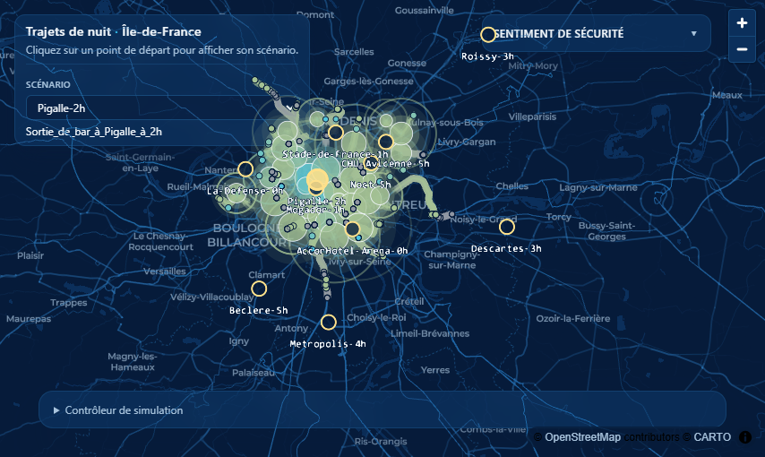

# Noctambulle · Trajets de nuit en Île-de-France

**Comment se vivent les trajets de nuit en transports en commun en Île-de-France ?** Noctambulle
est un visualisateur de trajets nocturnes qui met en regard leur durée, les portions à pied ou en
attente, l'éclairage nocturne, la densité de population et la fréquentation estimée à bord.

> **Prototype de hackathon.** Développé par l'équipe setec dans le cadre du
> [Hackaviz Mobilités 2026](https://github.com/hackathons-mobilites/hackaviz_2026), organisé par
> Île-de-France Mobilités du 2 au 26 novembre 2026. Ce projet est une démonstration de concept,
> pas un outil de planification ni une mesure objective de la sécurité. Un indice défavorable,
> un faible éclairage ou une faible fréquentation ne constituent pas une preuve qu'un lieu est dangereux.



## Présentation du projet

La nuit, connaître la durée d'un trajet ne suffit pas toujours à comprendre l'expérience d'une personne.
Un long temps d'attente, une marche de correspondance ou un trajet qui n'est pas réalisable avant le
matin peuvent compter autant que le temps passé dans les transports.

Noctambulle permet d'explorer ces dimensions sur une carte animée de l'Île-de-France. Il s'adresse aux
personnes qui se déplacent la nuit, pour le travail comme pour les loisirs, ainsi qu'aux équipes qui
réfléchissent à l'offre de transport et à son environnement.

### Le problème et la proposition de valeur

La vie nocturne occupe une place importante dans la dynamique économique francilienne. Au-delà des
activités de loisirs, de nombreux actifs réalisent des prises de poste en horaires décalés :
travailleurs hospitaliers, opérateurs des plateformes aéroportuaires, employés des marchés
internationaux, agents de propreté ou salariés des lieux de loisirs. De nombreux visiteurs se
déplacent aussi lors de grands événements comme les concerts ou les rencontres sportives.

Ces lieux ont un rayonnement régional et attirent clients, employés et visiteurs de toute
l'Île-de-France. L'offre nocturne repose notamment sur le réseau Noctilien, organisé autour de grands
pôles parisiens et desservant aussi des pôles de petite et grande couronne. La moindre couverture des
zones peu denses accentue les écarts d'accessibilité entre Paris, la proche banlieue et la grande
couronne. Pour certains déplacements, le retour peut approcher deux heures ou imposer d'attendre les
premiers services du matin.

À ces inégalités territoriales s'ajoute le sentiment d'insécurité, qui doit être distingué de
l'insécurité elle-même. L'absence d'éclairage ou de présence humaine peut être inconfortable pour
certaines personnes, pendant les attentes, les cheminements à pied ou à bord d'un véhicule peu
fréquenté. Ce ressenti peut influencer le choix modal et conduire à délaisser les transports
collectifs, renforçant les inégalités de mobilité.

Les horaires et les itinéraires indiquent où et quand l'on peut se déplacer, mais ne décrivent pas à eux
seuls cet environnement. La carte rapproche ces informations sans prétendre prédire le ressenti
individuel ni mesurer objectivement le danger.

### La solution

Noctambulle anime les trajets depuis un point de départ à une heure donnée vers les mairies des
communes d'Île-de-France ; Paris est représentée par ses vingt arrondissements. Le calculateur
d'itinéraires simplifié s'appuie sur un **CSA (Connection Scan Algorithm)** pour les transports
collectifs et sur **Dijkstra** pour les cheminements piétons. Il recherche l'arrivée la plus tôt
possible, plutôt que le trajet le plus court en distance. Les scénarios (lieu × heure de départ)
sont précalculés, puis animés dans l'interface : ce ne sont pas des déplacements observés en temps réel.

Les indices locaux décrivent trois indicateurs :

- **à pied et en attente** : la moyenne à poids égaux de l'éclairage nocturne et du contexte
  de densité de population ;
- **en transport** : la fréquentation estimée à partir des validations et de l'offre programmée,
  ajustée selon la catégorie de véhicule. Ce proxy n'est pas une mesure de charge ni un comptage
  des voyageurs effectivement visibles à bord.

Les scores sont normalisés entre 0 et 1, où 1 indique le contexte le plus favorable selon ces
hypothèses. Le score global combine les moyennes temporelles de ces trois indicateurs. Le panneau
rouge/gris/vert règle leur importance (faible/normale/forte), puis normalise les poids pour obtenir
une somme de 100 % (un tiers chacun par défaut). Les couleurs locales restent propres à chaque tronçon.
La musique est activée par défaut à 50 % ; si le navigateur bloque la lecture automatique,
elle démarre à la première interaction. Elle peut être coupée dans les options.

À l'arrivée, les bulles représentent la **population de la commune ou de l'arrondissement**, issue
des données publiques, et non le nombre de voyageurs effectuant ce déplacement. Leur couleur
résume le score global pondéré du trajet. L'anxiété des dix minutes les plus défavorables reste
accessible dans l'infobulle, comme lecture complémentaire.

Les trajets de plus de deux heures sont affichés en gris comme peu plausibles : une personne
pourrait choisir un autre mode. C'est une convention du prototype, pas une observation de comportement.
Une donnée attendue mais manquante reste indisponible.

Les données mobilisées sont :

- les horaires théoriques GTFS d'Île-de-France Mobilités ;
- le réseau routier et piéton d'OpenStreetMap ;
- les validations journalières et profils horaires des réseaux de surface et ferré du quatrième
  trimestre 2025, période confirmée par le bilan de couverture des estimations ;
- le raster d'éclairage nocturne préparé par l'équipe (`luminosite_log.tif`, déjà en échelle
  logarithmique, maille de 130 m) ; sa source amont et son unité physique restent à documenter ;
- le raster de contexte de densité `PresenceHum_IDF_OK.tif` préparé par Victoria
  (maille de 100 m, Lambert 93), converti par `1 - valeur / 100` : 0 brut est favorable,
  100 brut défavorable selon la convention fournie. Sa construction amont reste à documenter ;
  il ne mesure pas la présence humaine observée la nuit ;
- les populations et positions de mairie des communes et arrondissements via `geo.api.gouv.fr`.

La densité d'équipements générant de l'activité la nuit, à partir des données « amenities »
d'OpenStreetMap, est une piste d'enrichissement : **elle n'est pas intégrée au score actuel**.

Noctambulle vise ainsi à rendre lisibles les écarts de temps de parcours et de contexte nocturne,
pour les actifs comme pour les voyageurs de loisir, sans assimiler ces indicateurs à un diagnostic
de sécurité.

### Les problèmes surmontés et les enjeux en matière de données

L'absence de données de validation sur certaines lignes impose des hypothèses et des imputations
pour estimer la fréquentation. De plus, les validations renseignent la fréquentation d'une ligne
ou d'une station, mais ne permettent pas de reconstituer directement la **charge par interstation**.
L'approximation est donc importante : une estimation de validations par service n'est pas
l'occupation du véhicule.

Des serpents de charge par tranche horaire, ou des matrices origine-destination (OD) permettant de
les reconstituer, rendraient l'indicateur à bord plus pertinent. Des données issues, par exemple,
des enquêtes TJRF sur le métro ou des enquêtes OD à bord des bus pourraient contribuer à cette amélioration.
Les méthodes de repli et les limites des estimations actuelles sont détaillées dans le
[README de la fréquentation](services/ridership/README.md).

La représentation actuelle relie un point d'intérêt nocturne à toutes les communes, avec des bulles
dimensionnées selon leur population. Elle ne décrit donc pas une demande de déplacement observée.
Une matrice OD par heure, par exemple issue de l'Enquête Globale Transport (EGT), permettrait de
représenter les destinations effectivement rejointes par les usagers depuis ce point d'intérêt.

Les scénarios de trajets bruts sont aussi volumineux (environ 150 Mo chacun). Une commande
reproductible les simplifie en préservant les temps et les types de tronçons ; les fichiers
utilisés par l'application font environ 10 Mo. L'architecture sépare le calcul des trajets,
l'évaluation des indicateurs et la visualisation. Le frontend consulte les scénarios via l'API
routing et demande les indices à l'API safety.

Enfin, les horaires restent théoriques, la mairie représente la commune plutôt que l'adresse
réelle d'une personne, et les indicateurs ne couvrent qu'une partie du vécu nocturne. Des données
sur les cheminements accessibles, les correspondances piétonnes et l'état réel du service
aideraient à décrire plus fidèlement ces déplacements.

### Et la suite ?

Une première évolution serait d'accélérer les calculs CSA et Dijkstra et d'étudier l'utilisation
des API de PRIM. L'objectif serait de permettre à l'utilisateur de définir ses propres scénarios
et d'obtenir les résultats en quelques secondes, plutôt que de consulter uniquement des scénarios précalculés.

Un mode de recherche par **point et heure d'arrivée**, plutôt que de départ, permettrait de
visualiser les déplacements vers un lieu nocturne. Il serait particulièrement utile pour les prises
de poste tôt le matin, autour de 5 h, dans les aéroports, au MIN de Rungis ou dans les hôpitaux.

L'influence de la luminosité pourrait aussi être modulée selon l'heure, la saison et le lever du
jour : le modèle actuel applique le même raster aux trajets de fin de nuit, y compris dans un
scénario estival.

Les autres pistes sont de compléter les indicateurs avec l'activité nocturne, de confronter les
estimations de fréquentation aux observations et aux ressentis, de proposer des alternatives aux
trajets jugés peu plausibles et d'implémenter le rapport par scénario. Les seuils, les pondérations
et les choix de visualisation doivent être discutés avec les usagers et les partenaires.

## Installation et utilisation

### Prérequis

- [Git](https://git-scm.com/) et [Git LFS](https://git-lfs.com/) pour les fichiers de données volumineux ;
- [uv](https://docs.astral.sh/uv/) et Python 3.14 ;
- Node.js 20+ et npm pour le frontend.

### Démarrer l'application

Depuis la branche contenant cette version du prototype :

```text
git clone https://github.com/setec-labs/hackaviz-2026.git
cd hackaviz-2026
git switch florian
git lfs install
git lfs pull
uv sync --all-packages
cd frontend
npm ci
cd ..
uv run python scripts/run_services.py
```

Ouvrir ensuite <http://localhost:5173>. Les API sont également disponibles sur
<http://localhost:8001/docs> (routing) et <http://localhost:8002/docs> (safety). Arrêter les services
avec `Ctrl+C`.

Le guide d'installation complet, les conseils de dépannage et le mode de démonstration sans backend
sont dans [la documentation utilisateur](docs/utilisateur/index.md). Pour les commandes de tests et de
développement, consulter [CONTRIBUTING.md](CONTRIBUTING.md).

### Recalculer les scénarios et les estimations de fréquentation

Cette étape n'est pas nécessaire pour consulter les scénarios déjà versionnés. Les fichiers d'entrée
requis et les options sont décrits dans les README des services
[routing](services/routing/README.md) et [ridership](services/ridership/README.md).
Exécuter les commandes suivantes depuis la racine du dépôt.

Définir les scénarios dans `data/scenarios.json`, puis lancer :

```text
uv run --package routing transit-accessibility-scenarios --scenarios data/scenarios.json --all-communes
```

L'option `--max-destinations XX` limite le calcul à `XX` destinations.

Pour recalculer les estimations par arc en transport collectif, déposer dans
`data/input/frequentation/` les quatre fichiers attendus par le script :

- `profilshoraires-fer-T4-2026.csv` ;
- `profilshoraires-surface-T4-2026.csv` ;
- `validations-fer-T4-2026.csv` ;
- `validations-surface-T4-2026.csv`.

Ces noms de fichiers sont ceux utilisés par le script ; ils ne prouvent pas le millésime des
observations. Le bilan actuellement versionné indique une période source d'octobre à décembre 2025.

```text
uv run --package routing python services/ridership/ridership_surface.py
uv run --package routing optimize-scenarios
```

Le CSV produit est lu par safety. Après régénération, redémarrer les services pour recharger
les sources mises en cache.

## Documentation

La documentation couvre le [guide utilisateur](docs/utilisateur/index.md), les
[choix métier](docs/metier/index.md), les [limites connues](docs/metier/limites.md) et
l'[architecture](docs/architecture/index.md). Elle est construite avec
[Zensical](https://zensical.org/) :

```text
uv run zensical serve
uv run zensical build
```

## Licence

Le code et la documentation sont distribués sous licence [MIT](LICENSE).
