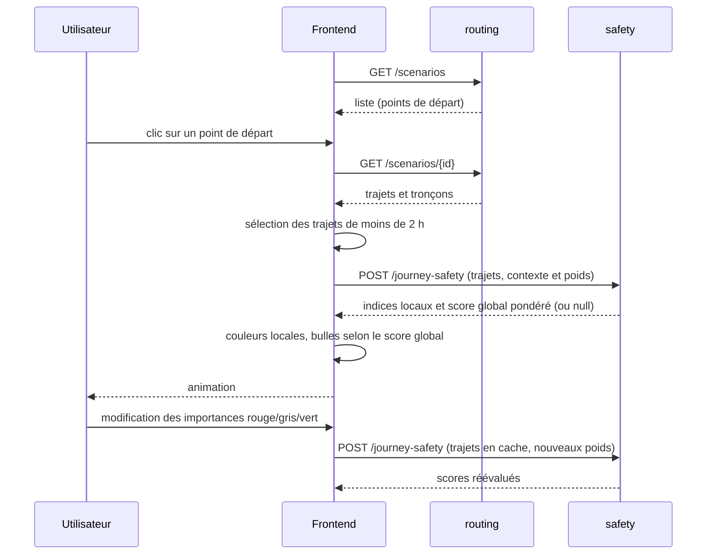
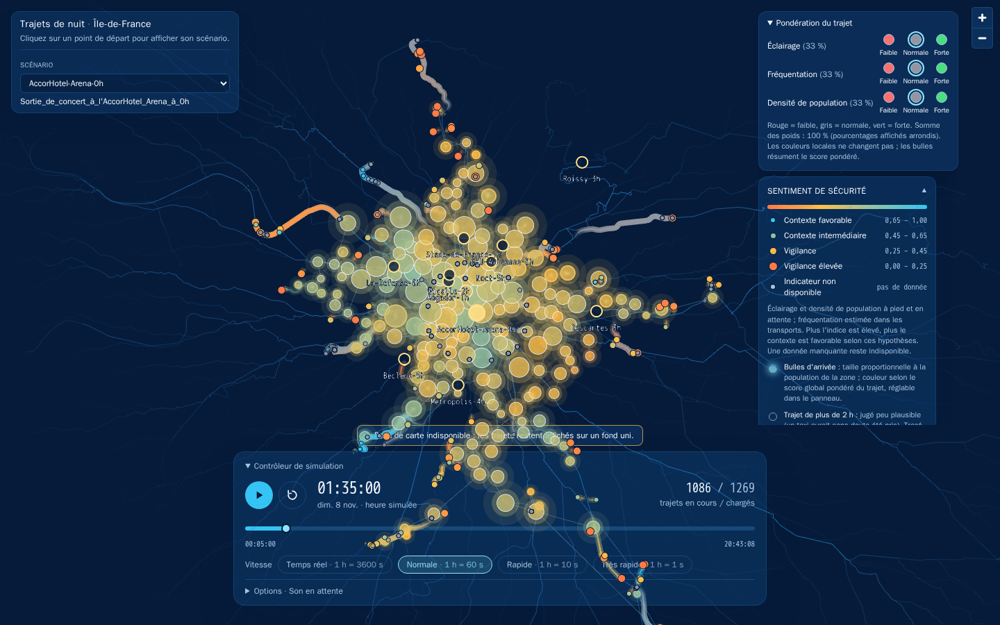
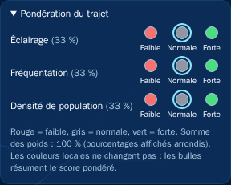
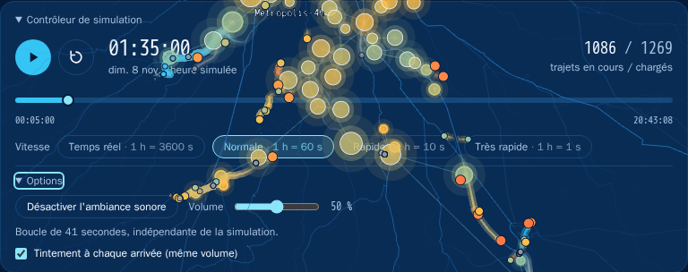

# Frontend

## Stack

| Outil | Usage |
|---|---|
| React 19 + TypeScript | interface (scénario, pondération, simulation, légende et son) |
| MapLibre GL | fond de carte sombre (OpenStreetMap, CARTO) |
| deck.gl 9 | couches WebGL : trajets animés (`TripsLayer`), points de départ, bulles d'arrivée |
| Tailwind CSS 4 | mise en forme |
| Vite 8 / Vitest | serveur de développement, build et tests |

## Organisation

| Dossier | Rôle |
|---|---|
| `api/` | clients HTTP de routing et safety, validation des réponses |
| `mocks/` | clients simulés pour le mode démonstration |
| `data/` | cache des trajets, alignement des scores safety, préparation des couches et arrivées |
| `domain/` | types, niveaux de l'indice, règle des 2 heures |
| `simulation/` | horloge de simulation et vitesses |
| `layers/` | construction des couches deck.gl et des infobulles |
| `map/`, `components/` | carte et composants React |
| `audio/` | démarrage de l'ambiance et tintements d'arrivée |
| `theme/` | palette du projet |

## Chargement d'un scénario

Les réponses sont validées à la réception (`api/validation.ts`) : une donnée mal formée produit une
erreur explicite plutôt qu'un affichage faux. Si safety échoue, les trajets restent affichés et l'indice
est « non disponible ».

`useTripData` conserve les trajets en cache : changer les poids ne recharge pas routing.
La requête safety précédente est annulée si le scénario ou les préférences changent. Les résultats
sont alignés par identifiant de trajet, puis les tableaux de scores restent alignés sur les coordonnées.
Chaque lot comprend au plus 100 trajets et 5 000 coordonnées, sans couper un trajet :
un trajet dépassant seul cette limite produit une erreur explicite.

## Interface et pondération

Capture de `AccorHotel-Arena-0h` avec les API réelles, en pause à 01:35.
Le bandeau d'indisponibilité du fond de carte est conservé : il décrit l'état réel
de la source cartographique pendant la capture.

Le sélecteur est en haut à gauche. Le panneau **Pondération du trajet** est en haut à droite,
au-dessus de la légende ; le contrôleur de simulation est en bas. Les panneaux peuvent être
repliés sans suspendre la simulation ni le son. La zone droite défile si la hauteur est insuffisante.
Sur un écran moins haut, replier la légende libère de la place pour les options sonores.

`IndicatorWeights` propose trois groupes de boutons radio natifs, un par indicateur :
`lighting`, `ridership` et `population_density`. Faible/normale/forte correspondent aux
importances 1/2/3, normalisées pour obtenir une somme de 1. Les pourcentages affichés
sont arrondis ; les poids transmis à l'API ne le sont pas. Par défaut, chaque indicateur
compte pour un tiers. Aucun calcul d'indicateur n'est déplacé dans le frontend.

Les préférences sont conservées dans l'état React pendant la session ; elles ne sont pas
persistées au rechargement. Les composants partagent les contrats TypeScript de
`api/contracts.ts`, alignés sur les modèles Pydantic.

## États et modes de données

| Situation | Comportement |
|---|---|
| Chargement du catalogue ou d'un scénario | état de chargement explicite |
| Erreur routing | message et bouton « Réessayer » |
| Échec safety | trajets conservés, scores indisponibles et avertissement |
| Catalogue ou scénario vide | message d'absence de données |
| Fond de carte inaccessible | fond uni avec avertissement, trajets conservés |
| Source simulée | badge visible ; scénarios et safety peuvent être simulés séparément |

Les variables `VITE_DATA_SOURCE`, `VITE_SAFETY_SOURCE`, `VITE_TRIPS_API_URL`,
`VITE_SAFETY_API_URL` et `VITE_MOCK_TRIP_COUNT` sont lues par `config.ts`.
Les paramètres d'URL prennent priorité pour le choix des sources et le nombre de trajets simulés.
Voir [Paramètres et performances](../utilisateur/parametres.md).

## Son

`SoundOptions` tente de lancer la boucle d'ambiance dès le montage, à 50 % du volume.
Si le navigateur refuse l'autoplay, `startAmbientPlayback` réessaie au premier clic
ou appui sur une touche et retire les écouteurs après démarrage. Une coupure volontaire
n'est pas annulée par les interactions suivantes. Le volume est partagé avec les tintements
et 0 % coupe le son. Le contrôleur ne lie pas l'ambiance à l'état lecture/pause de la simulation.

## Animation

- **Une seule horloge** (`SimulationClock`) et une seule boucle `requestAnimationFrame` pilotent
  l'animation.
- React ne se rend **pas** à chaque image : seules les couches deck.gl sont mises à jour. Le panneau de
  contrôle n'est notifié que toutes les 100 ms environ.
- Les données sont préparées une fois au chargement (couleurs par sommet, arrivées triées par heure), pour
  que chaque image se limite à un filtrage temporel.

## Accessibilité

- Palette du projet : fond `#061B3A`, trajet `#35C5F4`, vigilance `#FFBF47`, vigilance élevée `#FF7A45`.
- La couleur est toujours doublée : libellés de la légende, infobulles, taille et contour des bulles.
- Le son peut être coupé et son volume réglé ; les tintements sont espacés d'au moins 120 ms.
