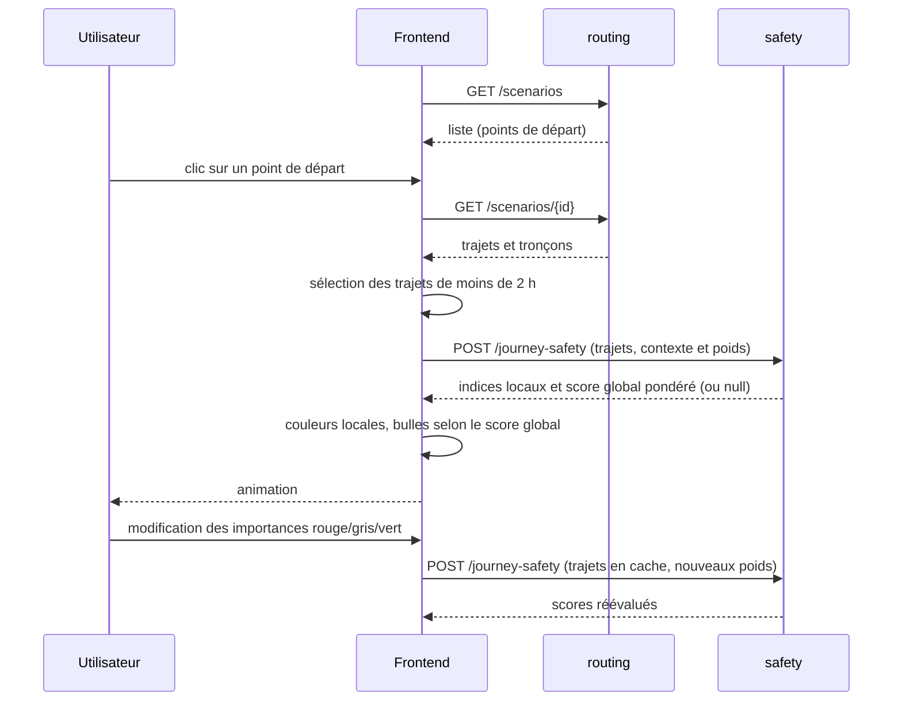

# Frontend

## Stack

| Outil | Usage |
|---|---|
| React 19 + TypeScript | interface (sélecteur de scénario, panneau de contrôle, légende) |
| MapLibre GL | fond de carte sombre (OpenStreetMap, CARTO) |
| deck.gl 9 | couches WebGL : trajets animés (`TripsLayer`), points de départ, bulles d'arrivée |
| Tailwind CSS 4 | mise en forme |
| Vite 8 / Vitest | serveur de développement, build et tests |

## Organisation

| Dossier | Rôle |
|---|---|
| `api/` | clients HTTP de routing et safety, validation des réponses |
| `mocks/` | clients simulés pour le mode démonstration |
| `data/` | chargement d'un scénario, échantillonnage pour safety, calcul des arrivées |
| `domain/` | types, niveaux de l'indice, règle des 2 heures |
| `simulation/` | horloge de simulation et vitesses |
| `layers/` | construction des couches deck.gl et des infobulles |
| `map/`, `components/` | carte et composants React |
| `audio/` | son d'arrivée |
| `theme/` | palette du projet |

## Chargement d'un scénario

Les réponses sont validées à la réception (`api/validation.ts`) : une donnée mal formée produit une
erreur explicite plutôt qu'un affichage faux. Si safety échoue, les trajets restent affichés et l'indice
est « non disponible ».

Le panneau transforme faible/normale/forte en importances 1/2/3, puis les normalise pour obtenir
une somme de 1. Aucun calcul d'indicateur n'est déplacé dans le frontend. Chaque lot comprend
au plus 100 trajets et 5 000 coordonnées, sans couper un trajet.

## Animation

- **Une seule horloge** (`SimulationClock`) et une seule boucle `requestAnimationFrame` pilotent
  l'animation.
- React ne se rend **pas** à chaque image : seules les couches deck.gl sont mises à jour. Le panneau de
  contrôle n'est notifié que toutes les 100 ms environ.
- Les données sont préparées une fois au chargement (couleurs par sommet, arrivées triées par heure), pour
  que chaque image se limite à un filtrage temporel.

## Accessibilité

- Palette du projet : fond `#061B3A`, trajet `#35C5F4`, vigilance `#FFBF47`, vigilance élevée `#FF7A45`.
- La couleur est toujours doublée : libellés de la légende, infobulles, taille et contour des bulles.
- Le son peut être coupé et son volume réglé ; les tintements sont espacés d'au moins 120 ms.
