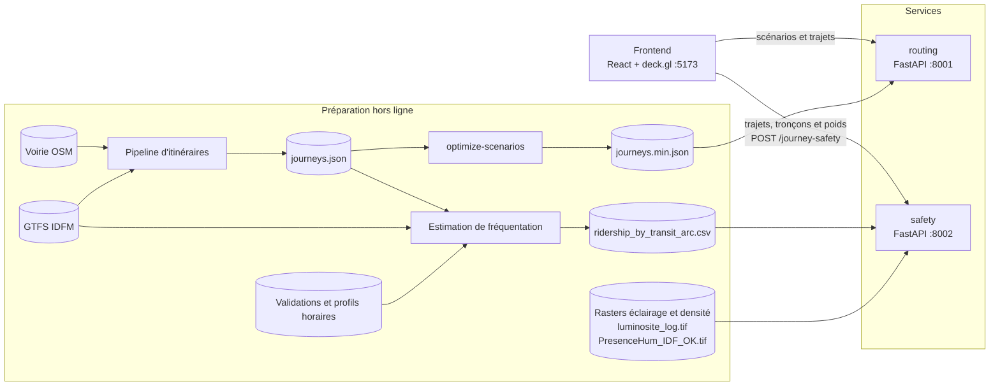

# Architecture

!!! info "Architecture de hackathon"
    L'objectif était d'avancer vite à plusieurs, sans se bloquer. Chaque brique a un périmètre clair et
    communique avec les autres par des contrats typés. Rien n'est prévu pour la production : pas
    d'authentification, pas de base de données, pas de déploiement.

## Vue d'ensemble

## Les briques

| Brique | Rôle | Détails |
|---|---|---|
| `frontend/` | carte, animation, légende, son | [Frontend](frontend.md) |
| `services/routing/` | calcul hors ligne des itinéraires et API des scénarios | [Services](services.md) |
| `services/ridership/` | estimation hors ligne de la fréquentation par arc ; pas de serveur HTTP | [Données](donnees.md#frequentation-par-arc) |
| `services/safety/` | indicateurs d'environnement nocturne normalisés | [Services](services.md) |
| `src/hackaviz_2026/` | modèles Pydantic partagés entre les services | [Services](services.md#modeles-partages) |
| `scripts/` | lancement de tous les services en une commande | [Développement](developpement.md) |

## Décisions structurantes

- **Calcul hors ligne, lecture en ligne.** Calculer un scénario prend environ 30 minutes. L'API routing ne
  calcule rien : elle sert des fichiers déjà produits.
- **Deux services indépendants.** Les trajets et les indicateurs évoluent à des rythmes différents et
  sont portés par des personnes différentes.
- **Contrats Pydantic partagés.** Les modèles échangés sont définis une seule fois dans
  `src/hackaviz_2026/`, et validés côté frontend à la réception.
- **Le frontend choisit, safety évalue.** Le frontend écarte les trajets de plus de deux heures
  de l'évaluation, puis transmet les trajets plausibles avec leurs tronçons, horaires et poids.
  Chaque lot contient au plus 100 trajets et 5 000 coordonnées. Safety applique les indicateurs
  dans leur contexte et calcule le score global ; le frontend ne le recalcule pas.
- **Deux niveaux de lecture.** Les couleurs locales décrivent le contexte de chaque tronçon.
  Les bulles d'arrivée utilisent le score global pondéré, indépendamment de leur taille
  qui représente la population de destination.
- **Mode démonstration.** Le frontend fonctionne sans backend (`?source=mock`), ce qui a permis de
  développer la visualisation avant que les données soient prêtes.

Le fonctionnement des indicateurs et leurs limites sont détaillés dans les
[choix métier](../metier/indicateurs.md). Les outils internes présentés par l'équipe
dans [Optiflow, Constellations, E-Toiles et SIGMAE](../metier/outils.md) sont des éléments
de contexte, pas des dépendances de cette application.
