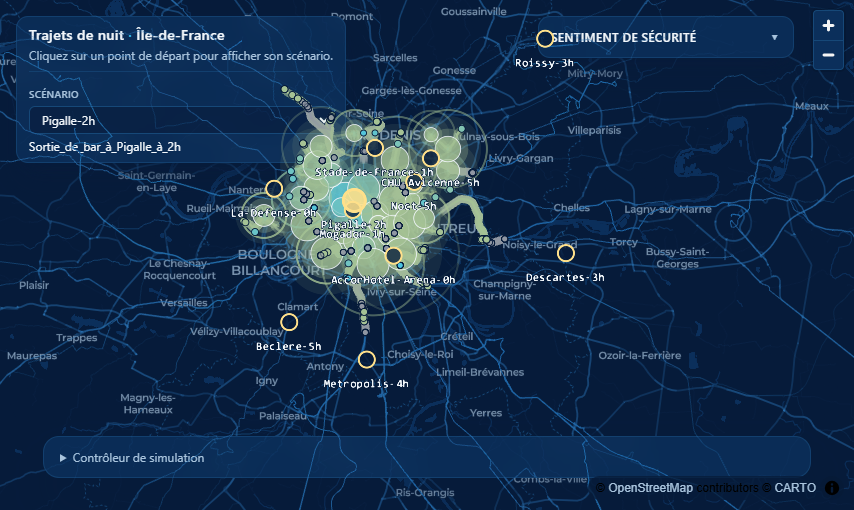

# Trajets de nuit en Île-de-France

!!! warning "Prototype de hackathon"
    Cette solution a été **développée en deux semaines** par une équipe setec dans le cadre du
    [Hackaviz Mobilités 2026](https://github.com/hackathons-mobilites/hackaviz_2026), organisé par
    Île-de-France Mobilités. C'est une démonstration de concept : les données, les indicateurs et le code
    n'ont pas la maturité d'un outil de production. Voir [Limites connues](metier/limites.md).

## L'idée

La nuit, un trajet ne se résume pas à sa durée. Attendre un bus de nuit sous un abri mal éclairé ou
marcher vingt minutes dans une rue déserte influence la façon dont le trajet est **vécu**.

Le prototype propose une **cartographie animée** des trajets de nuit en transports en commun en
Île-de-France. Il permet d'explorer, pour un lieu et une heure de départ donnés :

- **le temps de parcours** vers chaque commune francilienne ;
- **l'accessibilité** : marche, attente, correspondances, et trajets si longs qu'ils deviennent
  irréalistes ;
- **l'environnement nocturne** traversé à pied ou en attente, à travers un indicateur d'éclairage ;
- **le volume de population** concerné à l'arrivée.

!!! info "Un indicateur n'est pas une mesure du danger"
    L'indice affiché est un **indicateur pouvant contribuer au sentiment de sécurité**. Un faible
    éclairage ou un indice défavorable ne signifie pas qu'un lieu est dangereux. Voir
    [Choix métier](metier/index.md).

## Par où commencer ?

- **[Guide utilisateur](utilisateur/index.md)** : lancer l'application et lire la carte.
- **[Choix métier](metier/index.md)** : scénarios, indicateurs, seuils et hypothèses.
- **[Architecture](architecture/index.md)** : services, frontend et préparation des données.
- **[À propos](a-propos.md)** : le hackathon, l'équipe et les crédits.

