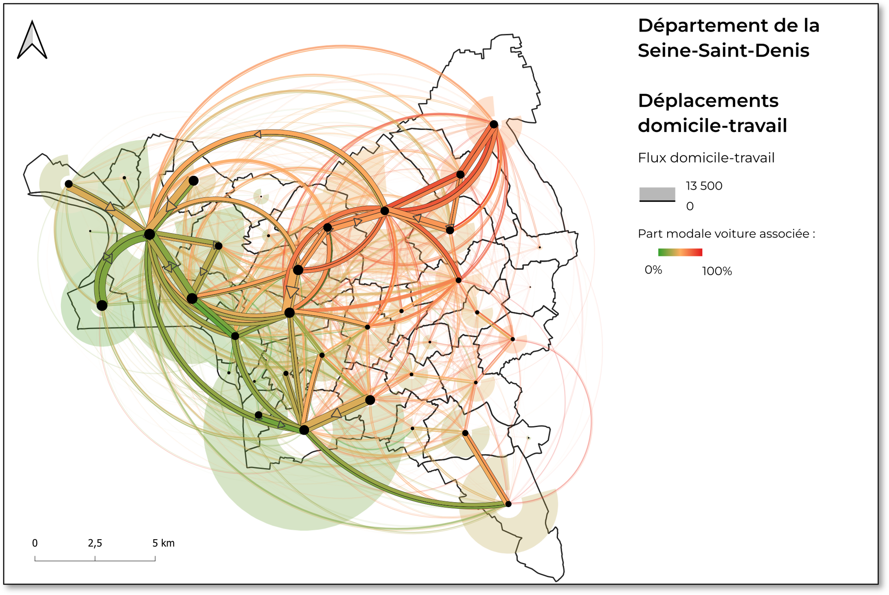

# Choix métier

Cette section rassemble les décisions qui donnent son sens à la visualisation : ce que l'on montre, comment
on le calcule et ce que l'on s'interdit d'en conclure.

## La question posée

> Pour une personne qui rentre de nuit en transports en commun, à quoi ressemble le trajet, au-delà de sa
> durée ?

Le prototype croise trois dimensions sur une même carte :

| Dimension | Ce qui est montré | Page |
|---|---|---|
| Temps de parcours | animation des trajets, heure d'arrivée | [Scénarios et trajets](scenarios.md) |
| Accessibilité | marche, attente, correspondances, trajets irréalistes | [Scénarios et trajets](scenarios.md) |
| Environnement nocturne | éclairage à pied/en attente, fréquentation estimée en transport et score pondéré | [Indicateurs](indicateurs.md) |

## Principes

1. **Un indicateur n'est pas une preuve de danger.** Les indicateurs décrivent un environnement qui peut
   contribuer au sentiment de sécurité ou d'insécurité. Un lieu peu éclairé n'est pas présenté comme
   dangereux, et les libellés parlent de « vigilance » et de « contexte », jamais de « danger ».
2. **Aucune valeur inventée en silence.** Une donnée manquante s'affiche « non disponible ». Les valeurs
   simulées (population ou indicateurs en mode démonstration) sont signalées dans
   la légende, les infobulles et cette documentation.
3. **Une convention de score unique.** Tous les indicateurs sont ramenés entre 0 (situation la moins
   favorable) et 1 (la plus favorable). Voir [Indicateurs](indicateurs.md#convention-de-score).
4. **La couleur n'est jamais le seul vecteur.** Taille des points, libellés, infobulles et légende
   doublent l'information portée par la couleur.
5. **Simple et explicable.** Dans le temps d'un hackathon, une règle simple et documentée vaut mieux qu'un
   modèle opaque. Les seuils retenus sont des choix de visualisation, pas des normes.

## Renoncements

L'exigence d'un code ouvert et libre nous a empêché de mettre en valeur dans le cadre de ce hackathon les différents outils d'analyse et de visualisation métier des données de transport que setec développe depuis deux ans. 
Ces outils, aux noms proches de la thématique abordée ici, auraient pu apporter d'autres regards sur le sujet.
Ces outils sont présentés brièvement dans notre page [savoir faire interne](outils.md).

