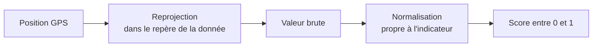

# Indicateurs

## Convention de score

Tous les indicateurs exposés par l'API safety renvoient un **score normalisé** compris entre 0,0 et 1,0 :
- **0** : situation la moins favorable ;
- **1** : situation la plus favorable.

La valeur brute d'une donnée source n'est jamais exposée directement. Chaque indicateur suit la même
chaîne :

L'**indice** affiché sur la carte est la moyenne, à poids égaux, des scores disponibles. Aujourd'hui, seul
l'éclairage est implémenté : l'indice est donc égal au score d'éclairage.

## Éclairage nocturne

| | |
|---|---|
| Source | raster de luminosité nocturne préparé par l'équipe |
| Résolution | maille de 130 m, Lambert 93 (EPSG:2154) |
| Valeurs | de 0 à 100, déjà en **échelle logarithmique** |
| Normalisation | `score = valeur / 100` |

Exemples : Châtelet ≈ 0,80 ; bois de Vincennes ≈ 0,18.

**Pourquoi une échelle logarithmique ?** La première version utilisait la luminosité en échelle linéaire.
Quelques zones très éclairées (centre de Paris, grands axes) écrasaient l'échelle et presque toute la
région apparaissait défavorable. La perception de la lumière étant elle-même plutôt logarithmique, le
raster a été refait en échelle log. Le service applique ensuite une simple division, pour ne pas appliquer
le logarithme deux fois.

**Hors couverture** : une position hors du raster ou sans donnée n'a pas de score et s'affiche « non
disponible ».

## Portions évaluées

L'indice n'est demandé **que sur les portions à pied et d'attente** (marche d'accès, correspondance,
marche finale ou directe, attente). C'est là que la personne est exposée à son environnement.

Dans un véhicule, la valeur est fixée provisoirement à **0,5**, une valeur neutre.

!!! todo "À faire"
    Évaluer le sentiment de sécurité **à bord** avec d'autres indicateurs (affluence, type de véhicule,
    présence de personnel…) plutôt que la valeur provisoire de 0,5.

## Seuils de lecture

La légende découpe l'indice en quatre niveaux. Ce sont des **choix de visualisation** :

| Niveau | Indice |
|---|---|
| Contexte favorable | 0,65 – 1,00 |
| Contexte intermédiaire | 0,45 – 0,65 |
| Vigilance | 0,25 – 0,45 |
| Vigilance élevée | 0,00 – 0,25 |

## Anxiété des 10 pires minutes

La couleur d'une bulle d'arrivée résume **tout le trajet** en une valeur : l'anxiété de ses **10 minutes
les plus défavorables**, consécutives ou non.

1. Le trajet est échantillonné toutes les 15 secondes.
2. Les 40 échantillons les plus défavorables (10 minutes) sont retenus, où qu'ils soient sur le trajet.
3. Leur indice moyen est calculé ; l'**anxiété** vaut `1 − indice moyen`.

Un trajet de moins de 10 minutes est pris en entier.

**Pourquoi ce choix ?** Une moyenne sur tout le trajet dilue les passages difficiles dans les longues
portions en transport. Un minimum ponctuel serait trop sensible à un seul pixel sombre. Les 10 pires
minutes reflètent mieux ce dont une personne se souvient : les moments où elle s'est sentie exposée,
même s'ils sont dispersés (un abri mal éclairé au départ, une rue sombre à l'arrivée).

!!! example "Exemple"
    Deux passages de 5 minutes à 0,2, séparés par 30 minutes favorables à 0,8, donnent un indice de 0,2 sur
    les 10 pires minutes, soit une anxiété de 0,8.
