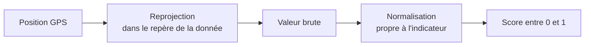

# Indicateurs

## Convention de score

Tous les indicateurs exposés par l'API safety renvoient un **score normalisé** compris entre 0,0 et 1,0 :
- **0** : situation la moins favorable ;
- **1** : situation la plus favorable.

La valeur brute d'une donnée source n'est jamais exposée directement. Chaque indicateur suit la même
chaîne :

L'**indice local** représente les indicateurs applicables au tronçon : moyenne à poids égaux
éclairage/densité à pied/en attente, fréquentation estimée en transport.
Le **score global** combine les trois indicateurs par une moyenne
pondérée configurable. Ce sont deux niveaux de lecture distincts.

## Éclairage nocturne

| | |
|---|---|
| Source | raster de luminosité nocturne préparé par l'équipe |
| Résolution | maille de 130 m, Lambert 93 (EPSG:2154) |
| Valeurs | de 0 à 100, déjà en **échelle logarithmique** |
| Normalisation | `score = 0` si `valeur < 50`, sinon `valeur / 100` |

Exemples : Châtelet ≈ 0,80 ; bois de Vincennes = 0 (valeur brute ≈ 18).

**Pourquoi une échelle logarithmique ?** La première version utilisait la luminosité en échelle linéaire.
Quelques zones très éclairées (centre de Paris, grands axes) écrasaient l'échelle et presque toute la
région apparaissait défavorable. La perception de la lumière étant elle-même plutôt logarithmique, le
raster a été refait en échelle log. Le service ne réapplique pas de logarithme.

**Pourquoi un seuil à 50 % ?** Une faible luminosité conserve un score nul pour accentuer le contraste,
notamment en dehors de Paris. Les valeurs strictement inférieures à 50 donnent 0 ; à partir de 50
inclus, le score reste la valeur divisée par 100 (50 donne 0,5). Ce seuil est un choix de modélisation
sur l'échelle du raster, pas une mesure physique ni une preuve qu'un lieu est dangereux.

**Hors couverture** : une position hors du raster ou sans donnée n'a pas de score et s'affiche « non
disponible ».

## Densité de population

Le raster `PresenceHum_IDF_OK.tif` préparé par Victoria est en Lambert 93 (EPSG:2154),
avec une maille de 100 m. C'est un indice préparé dans `[0, 100]`, pas une densité
en habitants/km² : selon la convention fournie, **0 brut est favorable et 100 brut défavorable**.
Le score vaut **`1 - valeur / 100`**, sans seuil ni nouveau logarithme.
La construction amont reste à documenter. Cet indicateur ne mesure pas les personnes
effectivement présentes la nuit et ne prouve pas qu'un lieu est sûr ou dangereux.
Hors couverture ou sans donnée, il reste indisponible.

## Portions évaluées

L'éclairage et la densité s'appliquent aux portions à pied et d'attente (marche d'accès, correspondance,
marche finale ou directe, attente).

En transport, l'indice utilise le champ `estimated_validations_per_service_adjusted` du fichier
`data/output/ridership/ridership_by_transit_arc.csv`. Ce champ est déjà un score inversé de 0 à 100 :
100 représente la fréquentation estimée la plus faible. Safety calcule donc **`1 − valeur / 100`**.
Une fréquentation plus élevée est considérée ici comme plus favorable : c'est une hypothèse,
pas une mesure objective de sécurité ni une mesure d'occupation des véhicules.

L'arc est identifié par le trajet GTFS, les deux arrêts et les instants de début/fin. Un arc inconnu
reste sans donnée ; aucun rapprochement géographique ni remplacement par 0,5 n'est effectué.
Les estimations incluent des imputations documentées dans `services/ridership/README.md`.

## Score global pondéré

Chaque indicateur est moyenné dans le temps sur ses portions applicables. Les deux rasters entre sommets
sont interpolés linéairement, avec prolongement des valeurs aux limites de chaque tronçon.
La fréquentation est constante sur un arc. Ces moyennes sont ensuite combinées :

`score = poids_éclairage × moyenne_éclairage + poids_fréquentation × moyenne_fréquentation + poids_densité × moyenne_densité`

Les poids totalisent 1. Le panneau propose faible (rouge, importance 1), normale (gris, 2) et forte
(vert, 3). Les importances sont divisées par leur somme : faible/faible/forte donne
20 %/20 %/60 %, normale/normale/normale donne un tiers chacun.
Ces couleurs représentent une préférence, jamais un niveau de danger.

Un indicateur sans portion applicable est exclu et les poids restants sont renormalisés.
Une donnée attendue mais manquante rend le score global indisponible si son poids est positif.
Sans durée positive ni poids applicable, le score est indisponible.
Les poids sont transmis à l'API, qui calcule le score ; le frontend ne recalcule pas les indicateurs.
Les couleurs locales ne changent pas avec les poids ; les bulles d'arrivée représentent le score global.

## Seuils de lecture

La légende découpe l'indice en quatre niveaux. Ce sont des **choix de visualisation** :

| Niveau | Indice |
|---|---|
| Contexte favorable | 0,65 – 1,00 |
| Contexte intermédiaire | 0,45 – 0,65 |
| Vigilance | 0,25 – 0,45 |
| Vigilance élevée | 0,00 – 0,25 |

## Anxiété des 10 pires minutes

L'infobulle conserve une lecture complémentaire : l'anxiété des **10 minutes les plus défavorables**,
consécutives ou non. Ce détail, distinct du score global pondéré, ne pilote plus la couleur des bulles.

1. Le trajet est échantillonné toutes les 15 secondes.
2. Les 40 échantillons les plus défavorables (10 minutes) sont retenus, où qu'ils soient sur le trajet.
3. Leur indice moyen est calculé ; l'**anxiété** vaut `1 − indice moyen`.

Un trajet de moins de 10 minutes est pris en entier.

**Pourquoi ce choix ?** Une moyenne sur tout le trajet dilue les passages difficiles dans les longues
portions en transport. Un minimum ponctuel serait trop sensible à un seul pixel sombre. Les 10 pires
minutes reflètent mieux ce dont une personne se souvient : les moments où elle s'est sentie exposée,
même s'ils sont dispersés (un abri mal éclairé au départ, une rue sombre à l'arrivée).

!!! example "Exemple"
    Deux passages de 5 minutes à 0,2, séparés par 30 minutes favorables à 0,8, donnent un indice de 0,2 sur
    les 10 pires minutes, soit une anxiété de 0,8.
