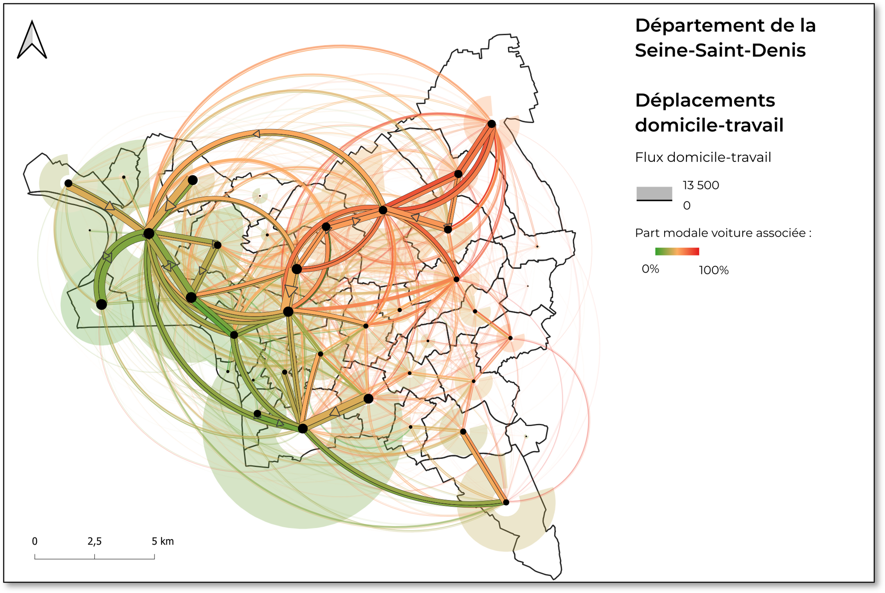
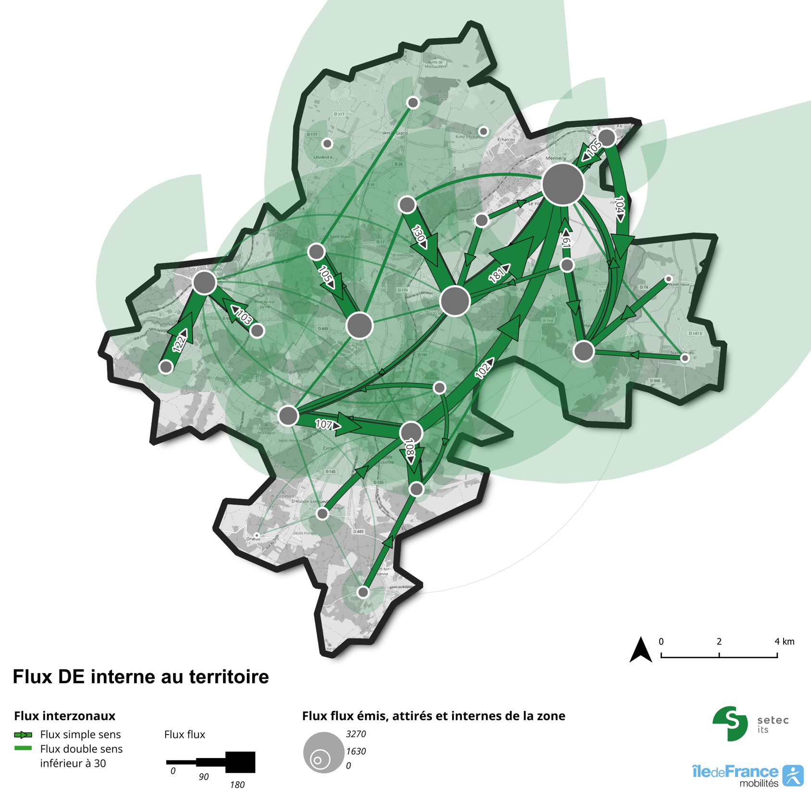
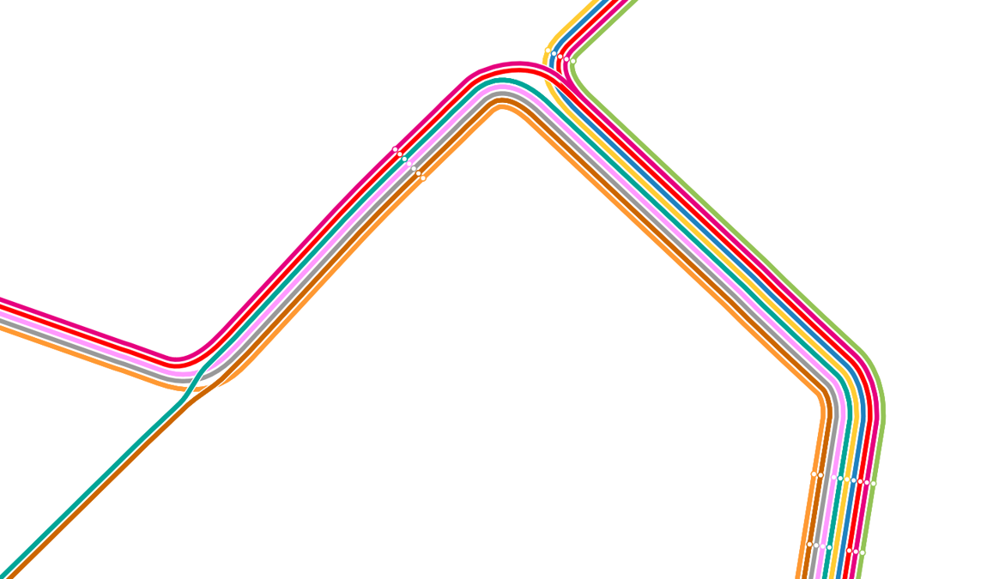
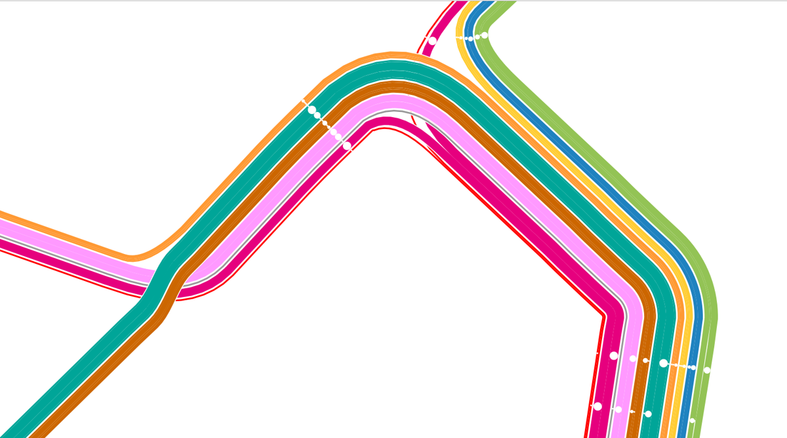
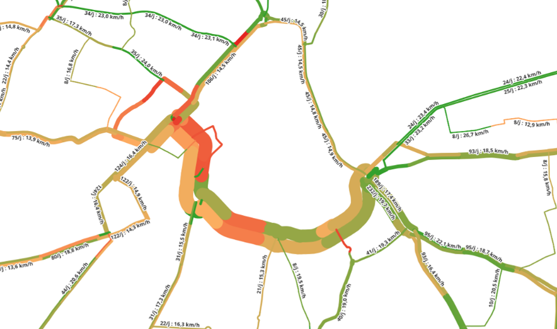
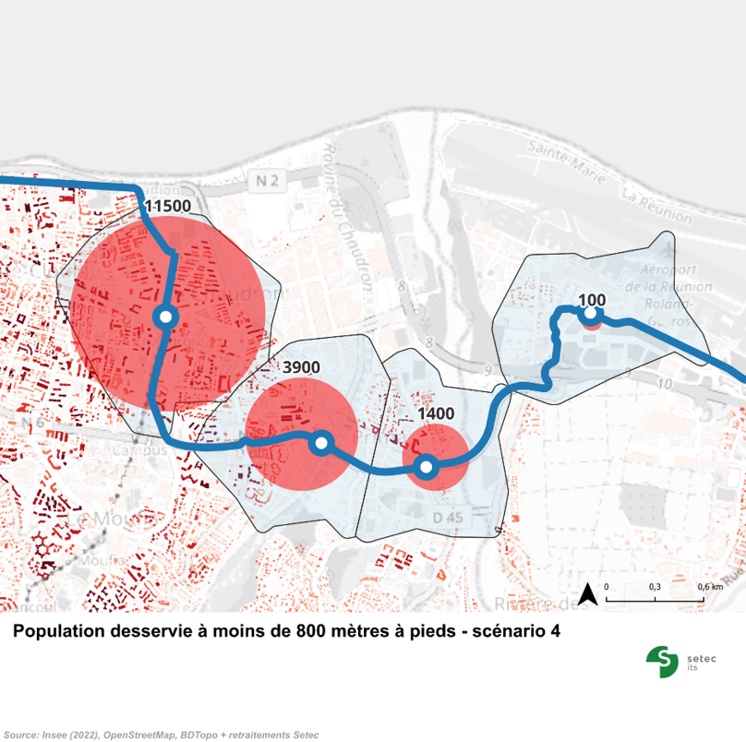
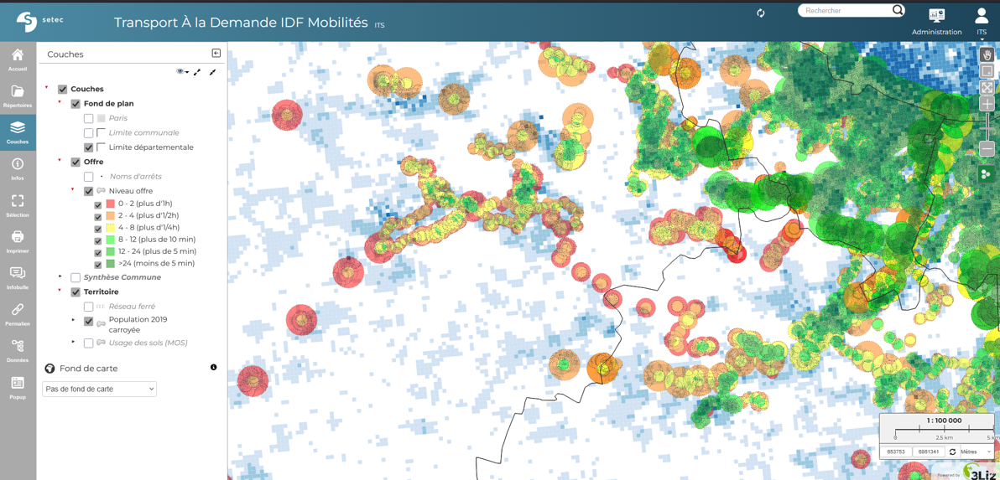

# La démarche Optiflow et la cartographie des transports chez setec

Fort d'une expertise de pointe dans les transports urbains, et d'un savoir faire en cartographie, setec investit depuis plusieurs années dans le développement d'outils de visualisation et de narration de ses études.

## La démarche Optiflow

Optiflow est le nom donné à une démarche de développement d'outils internes métiers pour l'interprétation, l'analyse et la visualisation des données de transport.

Conçue pour traiter tous types de données, elle permet notamment de valoriser les immenses potentiels des données opendata disponibles sur les réseaux de transport.

Développé avec un soucis permanent d'optimisation des temps de calcul, elle est faite pour permettre un travail itératif avec les clients de setec, potentiellement en atelier. Setec n'est alors plus un fournisseur d'études, mais un consultant expert qui assiste ses clients dans la coconstruction de leurs projets.

A ce jour, et en lien avec le présent hackaviz, nous pouvons présenter deux outils qui auraient été pertinents : Constellations et E-Toiles, dont les noms font écho au sujet que nous avons choisi d'aborder.

## Constellations

Constellations est l'outil développé pour visualiser les données de flux origine-destination sur un territoire.
Fondé sur une représentation optimisée des flux (une flèche double-sens aux couleurs et épaisseurs variables, pour contenir le plus d'information dans le moins de place), Constellations utilise un algorithme de placement optimisé des flèches pour limiter leurs croisements et optenir en quelques secondes de calcul un rendu harmonieux.

L'association du rendu optimisé et du placement harmonieux permet de représenter tous les flux sur une même carte, sans filtrer l'information arbitrairement.

Constellations inclue également des outils utiles à l'analyse en temps direct des données : ajout et suppression de zones, regroupement des zones, etc. Cela permet d'identifier des corridors de déplacement, des rutpures de charge, des archipels urbains, etc.

La facilité et la rapidité d'exécution de Constellations nous permet de le proposer sur de très nombreux cas pratiques : représentation des trajets sur un réseau de Transport à la Demande, Navettes Domicile-Travail entre communes en France comme à l'étranger (Canada, notamment), croissance des flux dans le temps, flux bénéficiants de gains de temps (par couleur) liés à un aménagement, etc.

## E-Toiles

E-Toiles est l'outil développé pour exploiter les données GTFS de description de l'offre de transport public.

E-Toiles importe les données GTFS et les restructure pour identifier les "missions" de chaque ligne, et les dessiner sur un réseau routier de référence.

Ainsi structurées en bases de donnée, les exploitations possibles sont nombreuses. Outre les requêtages habituels (temps de parcours, fréquence de desserte des arrêts, etc), il est alors possible de mesurer le nombre de passage de bus par rue, de calculer leurs vitesses moyennes théoriques par section, voire de proposer des plans de réseau dessinés automatiquement sur une partie ou la totalité du réseau.

E-Toiles embarque également un outil de tracé rapide de lignes de bus, et des outils de dessin d'isodistances concurrents et d'extraction de données socio-économiques, pour tracer de nouvelles lignes et en étudier la chalandise.

Les outils embarqués dans E-Toiles ont déjà permis de proposer aux équipes d'Ile-de-France Mobilités un visualisateur en webservice des trous d'offre dans le réseau TC francilien : 
