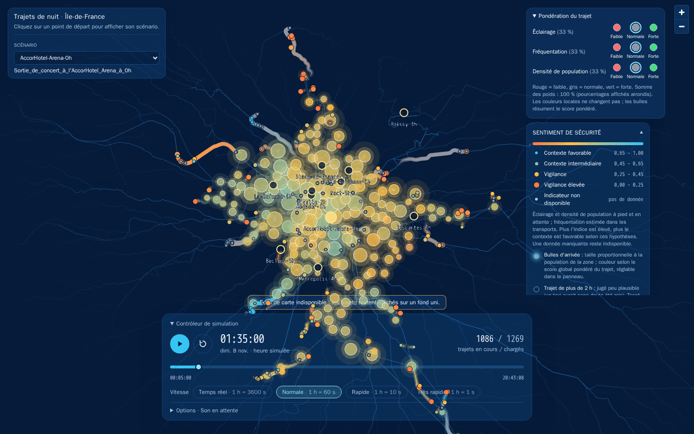
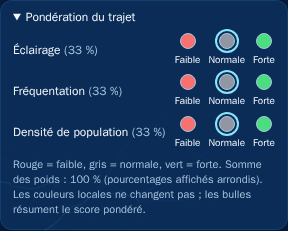
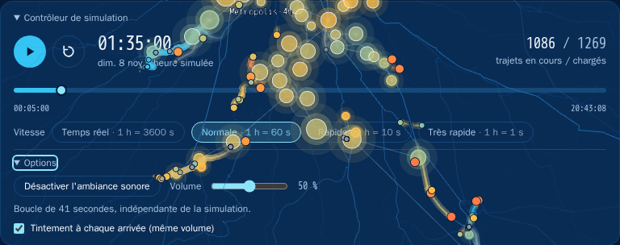

# Lire la carte

Capture du scénario `AccorHotel-Arena-0h`, issu du pipeline et évalué par safety,
en pause à 01:35. Le bandeau de fond de carte indisponible est conservé pour montrer
l'état réel de l'application pendant la capture.

Le scénario est choisi en haut à gauche. La pondération des trois indicateurs est en haut
à droite, au-dessus de la légende. Le contrôleur est en bas. Un clic sur le titre d'un
panneau le replie ou le déplie.
Si les options sonores débordent sur un écran peu haut, replier la légende pour libérer de la place.

## Choisir un scénario

Un **scénario** est un lieu et une heure de départ, par exemple une sortie de bar à Pigalle à 2 h du matin.
Ses trajets mènent vers toutes les communes d'Île-de-France.

- Les **points de départ** des scénarios sont affichés sur la carte. Leur survol affiche le nom, la
  description, l'heure de départ et le nombre de trajets.
- Un **clic** sur un point de départ charge son scénario. Le sélecteur « Scénario » en haut à gauche
  offre la même action au clavier.

## Piloter la simulation

Les trajets sont animés dans le temps, tous synchronisés sur une horloge simulée.

| Commande | Effet |
|---|---|
| Lecture / pause (ou ++space++) | démarre ou suspend l'animation |
| Recommencer | revient à l'heure de départ |
| Timeline | se déplace dans le temps simulé |
| Vitesse | 1 h simulée = 3 600 s (temps réel), 60 s, 10 s ou 1 s |

Le compteur « trajets en cours / chargés » indique combien de trajets sont encore en cours.
Ce n'est pas un comptage de personnes observées.
Le titre du panneau permet de le replier.

## Les trajets

Chaque trajet est une traînée lumineuse qui progresse de l'origine vers la destination, avec un point de
tête à la position courante.

**La couleur** suit l'indice lié au sentiment de sécurité, de 0 à 1 :

| Couleur | Niveau | Indice |
|---|---|---|
| cyan | contexte favorable | 0,65 – 1,00 |
| vert pâle | contexte intermédiaire | 0,45 – 0,65 |
| ambre | vigilance | 0,25 – 0,45 |
| orange | vigilance élevée | 0,00 – 0,25 |
| gris | indicateur non disponible | pas de donnée |

**La taille du point de tête** augmente avec le niveau de vigilance, pour que la couleur ne soit pas le
seul moyen de lire l'information.

!!! note "Où l'indice est-il évalué ?"
    Sur les portions **à pied et d'attente**, l'indice local est la moyenne éclairage/densité.
    Dans les transports, il utilise la fréquentation estimée de l'arc. Aucune valeur neutre
    n'est inventée lorsqu'une donnée manque. Voir
    [Indicateurs](../metier/indicateurs.md#portions-evaluees).

**Les trajets gris atténués** durent plus de 2 heures. Ils sont jugés peu plausibles : à cette heure, la
personne aurait sans doute pris un taxi. Leur indice n'est pas évalué.

## Les bulles d'arrivée

Quand un trajet arrive, une **bulle lumineuse** apparaît à la destination avec un anneau qui s'étend et,
si le son est activé, un tintement. Les bulles restent affichées et forment peu à peu une constellation :
chacune est reliée à l'arrivée précédente la plus proche.

- **Taille** : population de la commune d'arrivée.
- **Couleur** : score global pondéré du trajet (voir
  [Indicateurs](../metier/indicateurs.md#score-global-pondere)).
- **Bulle creuse et grise** : trajet de plus de 2 heures.

## Infobulles

Le survol d'un élément affiche une infobulle :

- **trajet** : destination, mode, horaires et indicateur au point courant ;
- **bulle d'arrivée** : destination, heure d'arrivée, population, score global et anxiété des 10 pires minutes ;
- **point de départ** : nom et description du scénario.

## Pondération du trajet

Le panneau propose trois indicateurs : éclairage, fréquentation estimée et densité de population.
Pour chacun, choisissez faible (rond rouge, importance 1), normale (gris, 2) ou forte (vert, 3).
Les importances sont renormalisées pour que les poids totalisent 100 %, avec un tiers chacun
par défaut. Les pourcentages affichés sont arrondis. Ce réglage change le score global et les
bulles d'arrivée, pas les couleurs locales. L'éclairage et la densité concernent la marche et
l'attente ; la fréquentation concerne le transport.

## Le son

Le panneau **Options** du contrôleur règle l'ambiance sonore :

- une **boucle d'ambiance**, activée par défaut à 50 % du volume (0 % pour couper) ;
- un **tintement** à chaque arrivée, plus grave pour les communes plus peuplées, désactivable par une
  case à cocher.

Si le navigateur bloque la lecture automatique, « Son en attente » s'affiche :
la musique démarre à la première interaction avec la page (clic ou touche), ou via
« Activer l'ambiance sonore ». Une désactivation volontaire reste respectée.
