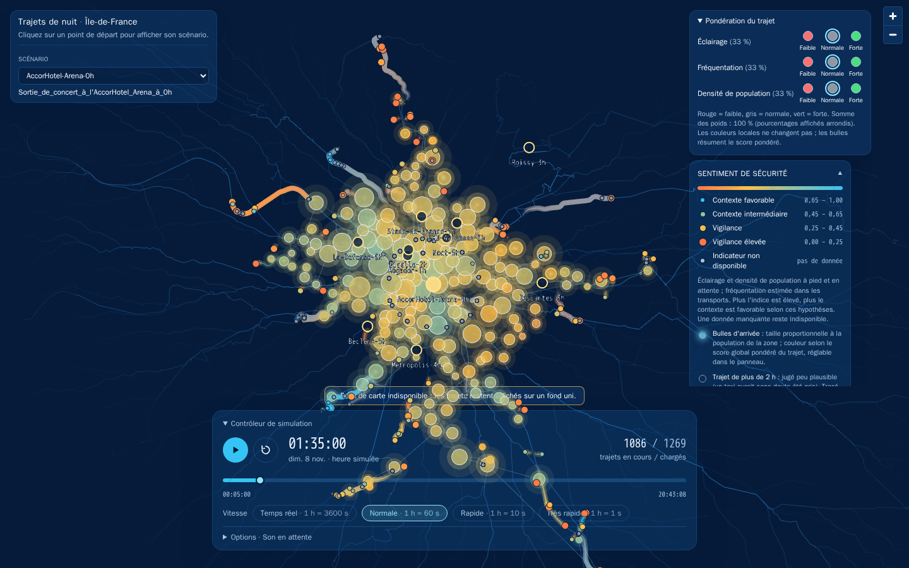

# Frontend

Cette brique contient l'interface de visualisation du projet Hackaviz Mobilités 2026 : une cartographie
interactive des trajets de nuit en Île-de-France, animés dans le temps et colorés selon un indicateur lié au
sentiment de sécurité.

Par défaut, les **scénarios et leurs trajets proviennent du service routing** (`GET /scenarios`, port 8001)
et l'**indice provient du service safety** (`POST /journey-safety`, port 8002) :
éclairage et densité de population à pied/en attente, fréquentation estimée en transport.
Sans service safety, les trajets s'affichent en
« non disponible » ; utiliser `?source=mock&safetySource=mock` pour travailler entièrement sans backend.

> L'indice affiché est un **indicateur**. Il ne mesure pas objectivement le danger d'un lieu. Les valeurs
> simulées sont synthétiques et sans lien avec des lieux réels.

## Aperçu de l'interface



Capture du scénario précalculé `AccorHotel-Arena-0h`, avec les deux API réelles,
en pause à 01:35. Le bandeau d'indisponibilité du fond de carte est conservé :
il reflète l'état de la source cartographique au moment de la capture.
Le [guide illustré](../docs/utilisateur/carte.md) détaille les panneaux et leur lecture.

## Stack

| Rôle | Outil |
|---|---|
| Interface | React 19 + TypeScript |
| Build / serveur de dev | Vite |
| Carte | MapLibre GL JS (fond vectoriel sombre CARTO / OpenStreetMap, sans clé) |
| Couches de données (GPU) | deck.gl (`TripsLayer`, `PathLayer`, `ScatterplotLayer`) via `@deck.gl/mapbox` |
| Styles | Tailwind CSS 4 |
| Tests | Vitest |

## Installation

Prérequis : Node.js 20.x à partir de 20.19, ou 22.12+ (npm est fourni avec Node).

uv gère les dépendances Python du monorepo mais pas les paquets JavaScript : les dépendances du frontend sont
donc gérées avec **npm**, dans ce dossier. Le fichier `package-lock.json` est versionné.

```powershell
cd frontend
npm ci
```

Pour ajouter une bibliothèque JavaScript :

```powershell
npm install <librairie>          # dépendance d'exécution
npm install -D <librairie>       # dépendance de développement
```

Le `pyproject.toml` de cette brique est conservé pour l'intégration au workspace uv ; aucune dépendance
Python n'est nécessaire au frontend.

## Lancer le prototype

```powershell
cd frontend
npm run dev
```

Pour lancer en même temps les services FastAPI, utiliser depuis la racine du repository
`uv run python scripts/run_services.py`.

Puis ouvrir <http://localhost:5173>. Le fond de carte nécessite un accès Internet ; en son absence, les
trajets restent affichés sur un fond uni.

Autres commandes :

```powershell
npm run typecheck   # vérification TypeScript
npm test            # tests unitaires (Vitest)
npm run build       # build de production dans dist/
npm run preview     # sert le build de production
```

### Paramètres de test (URL)

| Paramètre | Effet | Exemple |
|---|---|---|
| `source` | source des scénarios : `api` (défaut, service routing) ou `mock` | `?source=mock` |
| `safetySource` | source de l'indice : `api` (défaut) ou `mock` | `?safetySource=mock` |
| `trips` | nombre de trajets par scénario simulé (0 à 20 000) | `?trips=3000` |
| `seed` | graine des données simulées | `?seed=7` |
| `latency` | latence simulée des API, en ms | `?latency=0` |
| `mockError` | simule la panne d'un service mock (`trips` = routing, ou `safety`) | `?mockError=safety` |

Les valeurs par défaut peuvent aussi être définies avec `VITE_DATA_SOURCE`, `VITE_SAFETY_SOURCE` et
`VITE_MOCK_TRIP_COUNT` (voir `.env.example`). Le badge en haut à gauche indique ce qui est simulé.

### Utilisation

- **Lecture / pause** : bouton principal ou touche Espace.
- **Recommencer** : revient au début de la timeline.
- **Timeline** : le curseur permet de se déplacer dans le temps simulé.
- **Vitesse** : définit combien de secondes réelles représente 1 heure simulée
  (temps réel = 3 600 s, normale = 60 s, rapide = 10 s, très rapide = 1 s). Modifiable pendant l'animation.
- **Points de départ des scénarios** : le survol affiche le nom, la description, l'heure de départ et le
  nombre de trajets ; un clic sélectionne le scénario et charge ses trajets. Le sélecteur « Scénario » de
  l'en-tête offre la même action au clavier. Une description générée automatiquement (fichier sans
  `name`/`description`) est signalée comme telle.
- **Survol** d'un trajet ou d'un point : infobulle avec la destination, le mode, les horaires et
  l'indicateur au point courant.
- **Contrôleur de simulation** : cliquez sur son titre pour replier ou réafficher le panneau, sans arrêter
  la simulation ni le son.
- **Pondération du trajet** : pour l'éclairage, la fréquentation et la densité de population,
  choisir faible (rond rouge, importance 1),
  normale (gris, 2) ou forte (vert, 3). Les importances sont normalisées pour que les poids
  totalisent 100 % (un tiers chacun par défaut), puis transmis à safety.
  Les pourcentages affichés sont arrondis. Les bulles d'arrivée et les scores globaux changent,
  pas les couleurs locales. Un changement réévalue safety sans recharger les trajets routing.
- **Options → ambiance sonore** : boucle de 41 secondes, activée au démarrage à 50 % du volume
  (0 % pour couper le son), indépendante de la pause et de la vitesse de simulation.
  Si le navigateur bloque la lecture automatique, « Son en attente » apparaît dans Options :
  le son démarre à la première interaction (clic/touche), ou via « Activer l'ambiance sonore ».
  Une désactivation explicite n'est jamais annulée par les interactions suivantes.
- **Bulles d'arrivée (constellation)** : à la fin d'un trajet, une bulle lumineuse apparaît à la
  destination avec un anneau qui s'étend, puis reste affichée avec un halo scintillant. Sa **taille** suit
  la population de la zone et sa **couleur** le score global pondéré calculé par safety.
  Les moyennes temporelles de l'éclairage, de la fréquentation et de la densité sont combinées selon les poids
  du panneau. L'anxiété des 10 pires minutes reste un détail de l'infobulle. Chaque bulle est reliée à l'arrivée
  antérieure la plus proche, ce qui dessine une constellation. Le survol affiche la destination, l'heure,
  la population et l'indicateur.
- **Options → tintement** : un tintement est joué à chaque apparition de bulle, plus grave pour les zones
  plus peuplées, au même volume que l'ambiance. Il peut être désactivé par une case à cocher.

## Architecture

```text
frontend/
├── index.html
├── vite.config.ts
├── .env.example              # variables VITE_* (source de données, URL des API, volume du mock)
└── src/
    ├── main.tsx, App.tsx      # point d'entrée et assemblage de l'interface
    ├── config.ts              # configuration (.env + paramètres d'URL)
    ├── theme/palette.ts       # palette du projet (source TS) ; miroir Tailwind dans index.css
    ├── domain/                # types métier et lecture de l'indice (seuils, libellés, couleurs)
    ├── api/
    │   ├── contracts.ts       # contrats JSON attendus des API FastAPI (snake_case, provisoires)
    │   ├── validation.ts      # validation des réponses + conversion vers le domaine
    │   ├── clients.ts         # interfaces ScenariosClient / SafetyIndexClient
    │   ├── http/              # clients FastAPI (fetch)
    │   └── index.ts           # createDataClients : choix mock / API, source par source
    ├── mocks/                 # données simulées (trajets, champ d'indice, clients mock)
    ├── data/                  # chargement (états loading/error/success) et préparation pour le rendu
    ├── simulation/            # horloge de simulation commune + préréglages de vitesse
    ├── layers/                # couches deck.gl, positions courantes, infobulle
    ├── map/                   # carte MapLibre + overlay deck.gl, thème du fond de carte
    ├── components/            # composants UI (panneau de contrôle, légende, états, options sonores)
    ├── audio/                 # tintement d'arrivée (Web Audio)
    └── assets/                # sons locaux (ambient-loop.wav, arrival-chime.wav)
```

### Flux de données

```text
ScenariosClient.listScenarios() ──► ScenarioSummary[] ──► marqueurs cliquables + sélecteur
                                                              │ scénario sélectionné
ScenariosClient.fetchScenarioTrips(id) ──► Trip[] ──┐         ▼
                                                    ├─► prepareDataset ─► RenderDataset ─► couches deck.gl
SafetyIndexClient.fetchJourneySafety(trips, weights) ┘                                       ▲
                                                                   SimulationClock.onFrame ───┘
```

- Si le service **routing** échoue, un message d'erreur avec bouton « Réessayer » est affiché.
- Si le service **indice** échoue, les trajets restent affichés et l'indicateur est signalé
  « non disponible » (aucune valeur n'est inventée).
- Les trajets de **plus de 2 h** sont jugés peu plausibles (un taxi aurait sans doute été pris,
  `src/domain/tripPlausibility.ts`) : pas de requête d'indice, tracé gris neutre atténué, bulle d'arrivée
  creuse sans halo, mention dans l'infobulle et la légende.
- Les trajets plausibles sont envoyés avec leurs tronçons, identifiants GTFS, arrêts et horaires.
  Safety applique la moyenne locale éclairage/densité à pied/en attente et la fréquentation en transport, sans valeur
  neutre inventée. Une donnée attendue manquante reste `null`. Un indicateur sans portion
  applicable est exclu du score global et les poids applicables sont renormalisés.

### Horloge et performance

- Une **seule horloge** (`src/simulation/SimulationClock.ts`) et une seule boucle `requestAnimationFrame`
  pilotent toutes les animations : aucun timer par trajet, tous les trajets restent synchronisés.
- À chaque image, l'horloge appelle directement `overlay.setProps({ layers })` : **aucun rendu React par
  image**. L'interface React n'est notifiée qu'environ 10 fois par seconde (heure affichée, compteur).
- L'animation des traînées est faite sur GPU par `TripsLayer` (`currentTime`).
- Les positions courantes des trajets sont calculées dans des tableaux typés préalloués et transmises à
  deck.gl en attributs binaires (pas d'objet ni de composant par point).
- Testé visuellement avec `?trips=3000`.

### Lecture de l'indice

L'indice est normalisé entre 0 et 1 (1 = contexte le plus favorable). Sa représentation est définie dans
`src/domain/safetyLevels.ts` : dégradé continu cyan → ambre → orange de la palette, et quatre niveaux
libellés pour la légende. La taille du point de tête augmente avec le niveau de vigilance afin que la
couleur ne soit pas le seul vecteur d'information. Ces seuils sont un choix de visualisation : le calcul de
l'indice appartient au service `services/safety`.

## Données simulées

Toutes les données simulées sont dans [`src/mocks/`](src/mocks/) :

- `tripGenerator.ts` : génère un scénario au format de l'API routing (trajets depuis l'origine du scénario
  vers des pôles d'Île-de-France, modes et vitesses variés, départs étalés à partir du 10/11/2026 22:00) ;
- `safetyField.ts` : champ synthétique d'indice (zones aléatoires, quelques zones sans donnée) ;
- `mockClients.ts` : trois scénarios simulés, `MockScenariosClient` et `MockSafetyIndexClient`, qui
  implémentent les mêmes interfaces que
  les clients HTTP et passent par le **même validateur** que les réponses réelles.

Le pipeline routing fournit `destination.population`. À défaut (données simulées), la population des
bulles d'arrivée est simulée de façon déterministe à partir de l'identifiant du trajet (500 à 50 000 habitants, répartition
log-uniforme, `src/data/arrivals.ts`) et signalée « (simulée) » dans l'infobulle.

Les données sont déterministes pour une graine donnée et ne sont jamais codées dans les composants React.

## Brancher les API FastAPI

Le choix entre mock et API se fait uniquement dans `src/api/index.ts` (`createDataClients`), séparément
pour les scénarios (`VITE_DATA_SOURCE` / `?source=`) et pour l'indice (`VITE_SAFETY_SOURCE` /
`?safetySource=`). Aucun composant, couche ou hook n'a besoin d'être modifié.

- **Indice (branché)** : `POST {VITE_SAFETY_API_URL}/journey-safety` avec
  `{ "journeys": [...], "weights": {"lighting": 0.25, "ridership": 0.5, "population_density": 0.25} }`.
  Chaque résultat contient `journey_id`, `values` (par sommet), `score` (global) et `indicators`.
  Les scores sont dans `[0, 1]` ou `null`. Le client valide l'ordre, les identifiants et les tailles.
  Lots de 100 trajets et 5 000 coordonnées au plus, sans découper un trajet ; un trajet dépassant
  cette limite produit une erreur explicite. CORS autorise `http://localhost:5173`.
  L'ancienne méthode `fetchSafetyIndices` reste disponible pour l'API historique.
- **Scénarios (branché)** : `GET {VITE_TRIPS_API_URL}/scenarios` → `ScenarioSummaryDto[]`, puis
  `GET {VITE_TRIPS_API_URL}/scenarios/{id}` → `ScenarioDto` (trajets avec `coordinates` et `offsets_s`),
  servis par `services/routing` à partir des `journeys.json` du pipeline. Les DTO de `contracts.ts`
  reflètent les modèles Pydantic de `src/hackaviz_2026/routing.py` : les faire évoluer ensemble.

## Où travailler ?

Le code spécifique à l'interface doit rester dans cette brique. Le code ou les modèles nécessaires à
plusieurs briques ont vocation à être placés dans le package commun `src/hackaviz_2026/`.

## Avant de pousser vos modifications

Exécuter `npm run typecheck`, `npm test`, vérifier que `npm run dev` démarre correctement, puis pousser sur
votre branche personnelle. La Pull Request devra cibler la branche `develop`.


## Crédits sonores

`src/assets/arrival-chime.wav` est un extrait (1,85 s, mono) de « Cluster chimes 1 » (ID 2687),
LaSonotheque.fr.
